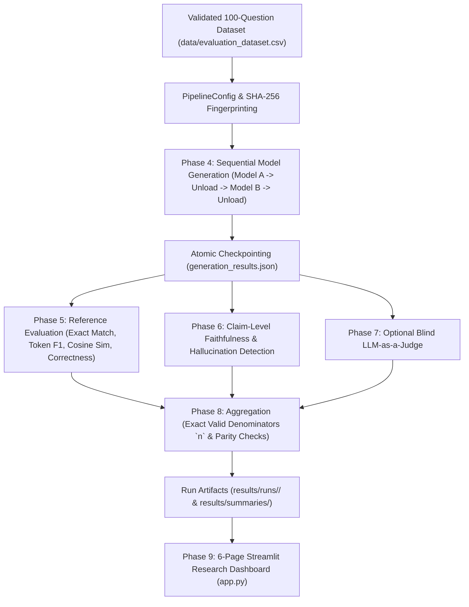

# LLM Hallucination Detection and Evaluation

**A Comparative, Modular Research Framework for Benchmarking Factual Correctness, Contextual Faithfulness, and Hallucinations Across Large Language Models**

This repository provides an end-to-end, reproducible evaluation framework for comparing local Hugging Face and API-backed Large Language Models (LLMs) on factual precision, reasoning, and hallucination resistance. It combines deterministic prompt/response generation, reference-based correctness scoring, claim-level NLI/evidence faithfulness verification, blind rubric-based LLM-as-a-Judge evaluation, atomic checkpoint recovery, and an interactive six-page Streamlit research dashboard.

---

## Key Research Principles

The framework enforces strict conceptual and statistical boundaries so evaluation numbers remain scientifically interpretable:

1. **Faithfulness != Factual Correctness != Hallucination:**
   - **Factual Correctness** (`src/evaluation/`) compares a generated answer against curated reference answers using exact/lexical matching, semantic similarity, key-term coverage, and numeric/refusal consistency.
   - **Contextual Faithfulness** (`src/hallucination/`) evaluates strictly whether atomic claims in an answer are supported by a *supplied context passage*—including counterfactual passages. Closed-book questions without context are **never** scored for context faithfulness.
   - **Unsupported != False:** Claims lacking sufficient support in context are labeled `NOT_ENOUGH_INFORMATION` rather than `CONTRADICTED`. Only claims with conflicting numbers, polarity flips, or high NLI contradiction probability are labeled `CONTRADICTED`.
   - **Contradiction Rate vs. Unsupported Claim Rate vs. Context Hallucination Rate:** Tracked separately; the aggregate context hallucination rate explicitly combines contradicted and unsupported claims.
2. **Semantic Similarity Is Not Correctness:** Embedding cosine similarity measures phrasing/topic closeness and can still be high when numbers or negations are wrong; therefore, numeric contradictions and refusal mismatches apply explicit score caps.
3. **Blind & Auditable LLM-as-a-Judge:** `src/judge/` hides generator identities during judging, tracks individual 1–5 rubric dimensions alongside the weighted overall score, logs raw judge responses, and treats `judge_confidence` strictly as an *uncalibrated self-report* rather than an objective probability.
4. **Honest Missing-Data & Denominator Handling:** Missing or disabled metrics stay `None`/`N/A` (never replaced with `0`), every aggregate reports its exact valid sample count `n`, and cross-model sample-size mismatches trigger explicit parity warnings.

---

## System Architecture



### Repository Layout

```text
LLM_Hallucination_Evaluation/
├── app.py                              # Main Streamlit dashboard entrypoint
├── dashboard/app.py                    # Alternate entrypoint delegating to app.main()
├── requirements.txt                    # Pinned Python dependencies
├── .env.example                        # Environment template (cache paths, defaults, optional API keys)
├── data/
│   ├── evaluation_dataset.csv          # Tabular 100-question benchmark consumed by pipeline & UI
│   ├── raw/original_dataset.json       # Canonical raw JSON dataset
│   └── processed/validated_dataset.json# Schema-validated dataset with category metadata
├── models/
│   └── model_config.py                 # MODEL_REGISTRY, ModelSpec, GenerationConfig, custom registration
├── src/
│   ├── utils/
│   │   ├── config.py                   # AppConfig, PathConfig, EvaluationConfig, HF cache & device resolution
│   │   └── data_loader.py              # Dataset loading and schema validation
│   ├── generation/                     # Phase 4: PromptBuilder, ModelLoader, local HF & API generators
│   ├── evaluation/                     # Phase 5: Lexical metrics, sentence-transformer similarity, Correctness
│   ├── hallucination/                  # Phase 6: Claim extractor, retriever, verifier, faithfulness, detector
│   ├── judge/                          # Phase 7: Blind rubric prompt, API/local client, JSON parser, judge metrics
│   ├── pipeline/                       # Phase 8: PipelineConfig, CheckpointManager, orchestrator, aggregation
│   └── dashboard/                      # Phase 9: Data loader, Plotly chart utils, and 6 Streamlit page modules
├── docs/                               # Phase-by-phase technical design documentation
├── results/                            # Gitignored run & summary directories (.gitkeep preserved)
└── tests/                              # Offline unit & UI-smoke test suite (51 pytest tests)
```

---

## Benchmark Dataset (`N = 100`)

Defined and validated in `data/evaluation_dataset.csv`, `data/raw/original_dataset.json`, and `data/processed/validated_dataset.json` (documented in [docs/dataset_design.md](docs/dataset_design.md)):

### Category Distribution

| Category | Count | Focus |
| :--- | :---: | :--- |
| General Knowledge | 15 | Verifiable geography, culture, and world facts |
| Science and Technology | 15 | Physics, chemistry, biology, and computer science precision |
| Mathematics | 15 | Programmatically verified arithmetic, algebra, calculus, combinatorics, probability |
| History | 10 | Unambiguous historical dates, treaties, and figures |
| Logical Reasoning | 10 | Deductive syllogisms, constraint ordering, formal fallacies |
| Context-based Question Answering | 20 | Grounded extraction, unanswerable context, counterfactual rules, distractors |
| Adversarial and Hallucination Testing | 15 | False premises, insufficient info, ambiguity, uncertainty, fabricated citations |
| **Total** | **100** | |

### Hallucination Stress-Test Tags (`hallucination_test_type`)

- `factual_precision` (`65`), `context_supported_precision` (`8`), `unanswerable_from_context` (`5`), `counterfactual_context` (`4`), `false_premise` (`4`), `misleading_irrelevant_context` (`3`), `insufficient_information` (`3`), `ambiguous_question` (`3`), `fabricated_citation_or_number` (`3`), `uncertainty_acknowledgment` (`2`).

---

## Supported Models (`models/model_config.py`)

Pre-configured for low-VRAM hardware (`<= 4 GB` VRAM / `16 GB` RAM) with sequential load/unload (`gc.collect()` + CUDA cache clear) plus optional free-tier API models:

| Registry Key | Model ID | Backend | Architecture | Local VRAM |
| :--- | :--- | :--- | :--- | :---: |
| `qwen2.5-1.5b` | `Qwen/Qwen2.5-1.5B-Instruct` | `huggingface_local` | `causal_lm` | ~3.1 GB |
| `qwen2.5-0.5b` | `Qwen/Qwen2.5-0.5B-Instruct` | `huggingface_local` | `causal_lm` | ~1.1 GB |
| `tinyllama-1.1b` | `TinyLlama/TinyLlama-1.1B-Chat-v1.0` | `huggingface_local` | `causal_lm` | ~2.2 GB |
| `smollm2-1.7b` | `HuggingFaceTB/SmolLM2-1.7B-Instruct` | `huggingface_local` | `causal_lm` | ~3.4 GB |
| `flan-t5-base` | `google/flan-t5-base` | `huggingface_local` | `seq2seq_lm` | ~1.0 GB |
| `flan-t5-large` | `google/flan-t5-large` | `huggingface_local` | `seq2seq_lm` | ~1.6 GB |
| `hf-llama-3.1-8b` | `meta-llama/Llama-3.1-8B-Instruct` | `huggingface_api` | `chat_api` | 0 GB (`HF_TOKEN`) |
| `groq-llama-3.1-8b` | `llama-3.1-8b-instant` | `groq_api` | `chat_api` | 0 GB (`GROQ_API_KEY`) |
| `groq-llama-3.3-70b` | `llama-3.3-70b-versatile` | `groq_api` | `chat_api` | 0 GB (`GROQ_API_KEY`) |
| `gemini-2.5-flash` | `gemini-2.5-flash` | `gemini_api` | `chat_api` | 0 GB (`GEMINI_API_KEY`) |

Additional local or OpenAI-compatible models can be registered dynamically via `register_custom_model(...)`. Default auxiliary models in `AppConfig` / `.env.example` are `sentence-transformers/all-MiniLM-L6-v2` (embeddings) and `cross-encoder/nli-deberta-v3-small` (NLI verification).

---

## Installation & Environment Setup

### 1. Create a Virtual Environment & Install Dependencies

**Windows (PowerShell):**
```powershell
git clone https://github.com/GauravChhajed/LLM_Hallucination_Evaluation.git
cd LLM_Hallucination_Evaluation

python -m venv .venv
.\.venv\Scripts\Activate.ps1
python -m pip install --upgrade pip
pip install -r requirements.txt
```

*(Optional GPU support on Windows: as noted in `requirements.txt`, install a CUDA-enabled PyTorch wheel before/over `torch==2.15.0` if using an NVIDIA GPU.)*

**Linux / macOS:**
```bash
git clone https://github.com/GauravChhajed/LLM_Hallucination_Evaluation.git
cd LLM_Hallucination_Evaluation

python3 -m venv .venv
source .venv/bin/activate
python -m pip install --upgrade pip
pip install -r requirements.txt
```

### 2. Configure Environment Variables

Copy `.env.example` to `.env` and customize cache paths, compute device, or optional API keys (`.env` is gitignored and never read/exposed in the dashboard):

```bash
cp .env.example .env
```

Key settings in `.env.example`:
- `HF_HOME`, `HF_HUB_CACHE`, `SENTENCE_TRANSFORMERS_HOME` (defaulting to `D:\hf_cache` in `src/utils/config.py`; set to any directory on Linux/macOS/Windows).
- `DEVICE` (`auto`, `cuda`, or `cpu`).
- `HF_TOKEN`, `GROQ_API_KEY`, `GEMINI_API_KEY`, `OPENROUTER_API_KEY`, `OPENAI_COMPATIBLE_BASE_URL`, `OPENAI_COMPATIBLE_API_KEY` (only needed if running API-backed generators or judges).

---

## Quick Start

### 1. Launch the Interactive Streamlit Dashboard

```powershell
streamlit run app.py
```

*(Or `streamlit run dashboard/app.py`, which delegates directly to `app.main()`.)*

Dashboard pages (`src/dashboard/`):
1. **Overview:** Saved run summary, generation status counts, core metrics with exact `n` sample counts, and filtered CSV/JSON exports.
2. **Model Comparison:** Side-by-side metric table, radar & bar charts, category breakdown, and cross-model sample-size parity warnings.
3. **Hallucination Analysis:** Context-only claim breakdown (`SUPPORTED`, `CONTRADICTED`, `NOT_ENOUGH_INFORMATION`), contradiction vs. unsupported vs. context hallucination rates, and claim-evidence inspector.
4. **Question-Level Analysis:** Multi-filter explorer (`Question ID`, `Category`, `Difficulty`, `Model`, `Hallucination test type`, `Generation status`, `Correctness label`).
5. **LLM-as-a-Judge:** Five 1–5 rubric dimensions, weighted overall score, `judge_confidence` caveats, and raw judge response logs.
6. **Experiment Management:** Browse/refresh saved runs, upload custom CSV datasets, inspect masked API key status (`Configured` / `Not set`), preview `PipelineConfig`, and trigger or resume runs explicitly via **Run Evaluation**.

### 2. Run the Checkpointed Evaluation Pipeline in Python

```python
from models.model_config import GenerationConfig
from src.judge.judge_config import JudgeConfig
from src.pipeline import PipelineConfig, run_evaluation_pipeline

config = PipelineConfig(
    models=["qwen2.5-1.5b", "flan-t5-large"],
    max_questions=10,  # Pilot slice before running all 100 questions
    generation_config=GenerationConfig(max_new_tokens=256, temperature=0.0, do_sample=False, seed=42),
    enable_reference_evaluation=True,
    enable_hallucination_detection=True,
    enable_judge=False,  # Set True and pass JudgeConfig(...) when using a judge model
    resume=True,
)

result = run_evaluation_pipeline(config)
print(result.run_id, result.output_files["model_summary_json"])
```

---

## Metric & Scoring Definitions

| Stage | Metric / Label | Definition & Thresholds |
| :--- | :--- | :--- |
| **Phase 4 (`generation`)** | `response_time_seconds` | Covers executed non-error attempts (`generation_status in {"success", "empty_response"}`) with finite recorded latency; excludes `"error"` and `"missing"` records. |
| **Phase 5 (`evaluation`)** | `correctness_score` & `correctness_label` | Normalized exact match → `1.0` (`correct`). Otherwise `0.40 * clamp(semantic_similarity, 0, 1) + 0.40 * key_info_coverage + 0.20 * token_f1` (re-normalized if semantic similarity is unavailable), capped at `<= 0.30` on numeric contradiction and `<= 0.35` on refusal mismatch. Labels: `contradictory_numeric`, `correct` (`>= 0.72`), `partially_correct` (`[0.42, 0.72)`), `incorrect` (`< 0.42`), or `unassessed` (`None`). |
| **Phase 6 (`hallucination`)** | `verification_label` (`SUPPORTED`, `CONTRADICTED`, `NOT_ENOUGH_INFORMATION`) | Computed per atomic claim on context-bearing questions. Numeric/temporal conflict (`topic_overlap >= 0.35`), negation polarity flip (`overlap >= 0.45`), or optional NLI `p_contradiction >= 0.60` → `CONTRADICTED`. NLI `p_entailment >= 0.55` (or hybrid semantic `>= 0.55`, key-term coverage `>= 0.50`, and grounded numbers) → `SUPPORTED`. Otherwise → `NOT_ENOUGH_INFORMATION`. |
| **Phase 7 (`judge`)** | 5 Rubric Dimensions (1–5) & `overall_score` | Weighted overall score: `Relevance` (`0.20`), `Factual Correctness` (`0.25`), `Completeness` (`0.20`), `Contextual Faithfulness` (`0.25`, `NOT_APPLICABLE` and re-normalized over `0.75` when no context is supplied), `Clarity` (`0.10`). |

---

## Output Artifacts (`results/runs/<run_id>/`)

Each pipeline run writes isolated, checkpointed files under `results/runs/<run_id>/` plus a summary copy under `results/summaries/<run_id>_summary.json`:

- `run_config.json` — Serialized `PipelineConfig` and SHA-256 dataset/config fingerprint for resume validation
- `generation_results.json` — Raw Phase 4 responses, token/timing metadata, and status flags
- `evaluation_results.json` — Phase 5 reference-based metrics (omitted if `enable_reference_evaluation=False`)
- `hallucination_results.json` — Phase 6 claim-level verifications and ratios (omitted if `enable_hallucination_detection=False`)
- `judge_results.json` — Phase 7 rubric scores, rationales, and raw judge responses (omitted if `enable_judge=False`)
- `combined_results.json` & `question_level_results.csv` — Unified per-question/per-model records
- `model_summary.json` — Overall and category-wise aggregates with exact `n` counts and parity warnings
- `run_metadata.json` — UTC timestamps, dataset hash, Python/package versions, resolved device, and omitted-file notes

---

## Testing

The test suite runs completely offline using mocked models/providers and Streamlit `AppTest` UI smoke checks (`51` tests across 8 test modules):

```powershell
pytest -v
```

Test modules:
- `tests/test_config.py` (5) — Environment, dependencies, PyTorch/device fallback, HF cache config, `MODEL_REGISTRY`
- `tests/test_dataset.py` (9) — Canonical 100-item dataset distribution, math verification, validation edge cases
- `tests/test_generation.py` (6) — Prompt builder, model loader, causal/seq2seq/API mocks, paired persistence
- `tests/test_evaluation.py` (7) — Normalization, numeric contradiction, cosine similarity, batch persistence
- `tests/test_hallucination.py` (8) — Claim extraction, counterfactual/irrelevant/no-context handling, broad rates
- `tests/test_judge.py` (5) — Blind prompt, JSON parser validation, API error handling, refusal/no-context rules
- `tests/test_pipeline.py` (5) — End-to-end orchestration, checkpoint resume/mismatch/corruption, isolated failures
- `tests/test_dashboard.py` (6) — Run discovery, filtering, CSV/JSON export, secret masking, denominator checks, 6-page `AppTest` smoke suite

---

## Detailed Documentation

- [Dataset Design](docs/dataset_design.md)
- [Generation Design](docs/generation_design.md)
- [Evaluation Metrics](docs/evaluation_metrics.md)
- [Hallucination Detection](docs/hallucination_detection.md)
- [LLM-as-a-Judge](docs/llm_as_judge.md)
- [Pipeline Architecture](docs/pipeline_architecture.md)
- [Dashboard Guide](docs/dashboard_guide.md)

---

## Known Limitations

- **CPU Inference Latency:** Running all 100 questions across multiple local causal models on CPU-only PyTorch is latency-bound; use `max_questions` in `PipelineConfig` or the dashboard for pilot runs first.
- **Single-Turn & English-Only Scope:** The canonical benchmark evaluates 100 single-turn English prompts rather than multi-turn conversational drift or multilingual hallucination behavior.
- **Single-Answer Blind Judging:** LLM-as-a-Judge grades candidate responses independently against the rubric rather than performing pairwise head-to-head ranking, and remains subject to LLM judge verbosity, style, and self-preference biases.
