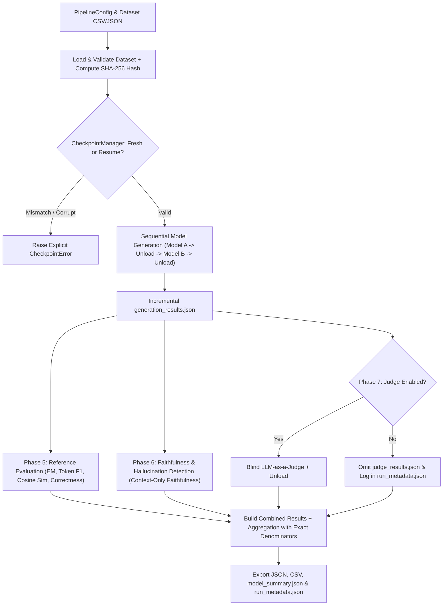

# Phase 8: Integrated LLM Evaluation Pipeline Architecture

## 1. Overview & Architecture Diagram

The `src/pipeline/` package orchestrates all prior project components—dataset loading (Phase 3), sequential response generation (Phase 4), reference-based lexical/semantic/correctness evaluation (Phase 5), claim-level faithfulness & hallucination detection (Phase 6), and optional blind LLM-as-a-Judge evaluation (Phase 7)—into a single reproducible, checkpointed workflow.

---

## 2. Module Responsibilities

| Module | Responsibility |
| :--- | :--- |
| **`pipeline_config.py`** | Defines `PipelineConfig`, validates unique model specs, computes dataset SHA-256 hashes, and builds `config_fingerprint` for resume compatibility. |
| **`checkpoint_manager.py`** | Performs atomic `.tmp`→`os.replace` writes for incremental checkpoints, validates `run_config.json` fingerprints on `resume=True`, and detects corrupted or mismatched checkpoints. |
| **`evaluation_orchestrator.py`** | Executes Phase 5, Phase 6, and optional Phase 7 evaluators independently with per-item exception isolation and incremental checkpointing. |
| **`aggregation.py`** | Computes per-model and category-wise mean/std/`n` metrics using exact valid denominators (excluding no-context items from faithfulness and `NOT_APPLICABLE` from judge contextual means) and flags cross-model sample-size mismatches. |
| **`result_manager.py`** | Joins generation and evaluation outputs into unified `combined_results.json`, flattened `question_level_results.csv`, `model_summary.json`, and `run_metadata.json` (with Python/package versions and omitted stage notes). |
| **`pipeline_runner.py`** | Exposes `EvaluationPipelineRunner` and `run_evaluation_pipeline(...)` with sequential model loading/unloading and injectable factories for offline testing. |

---

## 3. Execution Flow & Resource Management

1. **Sequential Generation (`sequential_model_execution=True`):** Models are instantiated one at a time, evaluated across identical ordered prompts, and explicitly unloaded (`generator.unload()` → `gc.collect()` + CUDA cache clear if present) before the next model loads. This keeps memory well within the machine's 15.65 GB system RAM and 4 GB VRAM budget.
2. **Independent Failure Handling:** A generation error on one question or a judge timeout/API failure on one item is captured in that record's status and error fields without aborting other models, other questions, or deterministic Phase 5/6 stages.
3. **Optional LLM-as-a-Judge:** When `enable_judge=False`, no API keys are required, no `judge_results.json` file is created, and `run_metadata.json` explicitly records `"judge_results.json": "Disabled via enable_judge=False."` under `omitted_stage_files`.

---

## 4. Result Storage Format (`results/runs/<run_id>/`)

Each run writes to an isolated directory `results/runs/<run_id>/`:

- `run_config.json` — Serialized `PipelineConfig` and compatibility fingerprint.
- `generation_results.json` — Raw Phase 4 `GenerationResult` records.
- `evaluation_results.json` — Phase 5 `EvaluationRecord` outputs (omitted if `enable_reference_evaluation=False`).
- `hallucination_results.json` — Phase 6 `HallucinationDetectionRecord` outputs (omitted if `enable_hallucination_detection=False`).
- `judge_results.json` — Phase 7 `JudgeEvaluationRecord` outputs (omitted if `enable_judge=False`).
- `combined_results.json` — Joined question-model records retaining all raw outputs, claims, and explanations.
- `question_level_results.csv` — Flat tabular export aligned 1-to-1 with `combined_results.json`.
- `model_summary.json` — Model-level and category-wise aggregates with explicit `n` counts and parity warnings.
- `run_metadata.json` — Timestamps, dataset hash, package versions, resolved device, stage counts, and omitted-file notes.

A summary mirror is also written to `results/summaries/<run_id>_summary.json`.

---

## 5. Checkpoint & Resume Behavior

- **Incremental Checkpointing (`save_incremental=True`):** Checkpoints are atomically written as each question/model completes.
- **Resume (`resume=True`):**
  - Verifies `dataset_hash`, `models`, `prompt_template_name`, `system_prompt`, `generation_config`, `embedding_model_id`, `nli_model_id`, and active judge config match `run_config.json` (raising `CheckpointMismatchError` otherwise).
  - Reuses completed `"success"` generations and `"evaluated"` records without re-running models.
  - Retries previously failed/empty items when `retry_failed=True`.
- **Corruption Safety:** Malformed or truncated checkpoint files raise `CheckpointCorruptedError` immediately rather than silently discarding partial runs.

---

## 6. Known Limitations

1. **CPU Inference Throughput:** Full 100-question local generation runs on CPU-only PyTorch (`torch==2.15.0+cpu`) remain latency-bound; use `max_questions` for small pilot runs before scaling up.
2. **Pairwise Judge Not Yet Included:** Consistent with Phase 7, models are judged independently via rubric scoring rather than pairwise comparison.
3. **Interactive Visualization Deferred:** Dashboard rendering and interactive filtering belong to Phase 9 (`dashboard/`).
